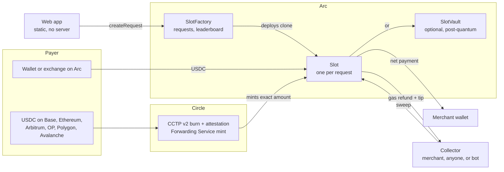

# ArcSlot

**Get paid in USDC for cents, not percent.**

[**Try it live**](https://arc-slot-three.vercel.app) · [**Docs**](https://arc-slot-three.vercel.app/#/docs) · on Arc testnet · Built with [Arc Studio](https://studio.arc.io)

---

Every business that invoices online hands 1.5–3% of every payment to a middleman. On a $1,000 invoice:

| How you get paid | What it costs you |
|---|---|
| Card | **$23.60** (2.36% average US interchange, [Motley Fool](https://www.fool.com/money/research/average-credit-card-processing-fees-costs-america/)) |
| Stablecoin processor | **$15.00** (1.5% per payment, [Yahoo Finance](https://finance.yahoo.com/news/stripe-charges-1-5-stablecoin-145737023.html)) |
| **ArcSlot** | **~$0.02** network fee. That's it. |

Stablecoins already won the argument: Stripe paid [$1.1 billion](https://www.nbcnewyork.com/news/business/money-report/stripe-closes-1-1-billion-bridge-deal-prepares-for-aggressive-stablecoin-push/6135508/) for a stablecoin company, and business stablecoin payments grew [733% in 2025](https://ambcrypto.com/stablecoin-volumes-surge-to-35-trillion-but-real-world-payments-still-lag-at-1/). The rails cost cents. The toll booths on top of them still charge percent. **ArcSlot removes the toll booth.**

## How it works

1. **Send a link.** Every invoice gets its own address that can only pay you.
2. **Your client pays from any wallet**: on Arc, or from Ethereum, Base, Arbitrum, OP Mainnet, Polygon or Avalanche through **Circle's CCTP**. Circle's Forwarding Service lands exactly the amount you asked for.
3. **It's yours in seconds.** No account, no payout schedule, no processor in between.

## Why it wins

- **Nobody holds your money. Not even us.** Funds go from the payer to an address only you can collect from. If this website disappeared tomorrow, every link would still work.
- **Exact amounts, any chain.** The payer covers the cross-chain fee; you receive the full invoice.
- **Mistakes are recoverable.** Every request has the same address on every chain, so USDC sent on the wrong network can be recovered.
- **Built for software, not just people.** Any app or AI agent can create and pay invoices with one contract call. No API key, no sign-up.
- **Security you can check.** An optional quantum-safe vault (post-quantum signatures, verified on Arc), and Circle's USDC compliance controls respected on every payout.

## Proof

- **Live and working** on Arc testnet: create a link, pay it from Arc or from Ethereum Sepolia, collect it. Real payments, every step on-chain ([create](https://explorer.testnet.arc.io/tx/0xb1c63ec19f9746d9b4dd12154962fd091a00953390a4614e9f518f88d0ecd012), [pay](https://explorer.testnet.arc.io/tx/0xdb755498676c516178543af264de05aea67c60cf621fb2dfd049e482bbff847a), [collect](https://explorer.testnet.arc.io/tx/0x9aabaec545abd14e75d135442b5b2664d11a3a0d34669998cec855716f2732f7)).
- **Hardened:** 300+ automated tests, a 1,000-actor randomized stress campaign, two security reviews in Arc Studio and an independent white-hat review, with every finding fixed. (No third-party audit yet.)
- **Fully public code:** everything that touches money is in this repo, readable by anyone.

---

# Under the hood

For builders and reviewers: the contracts, the cross-chain flow and how to run it. The full guide lives at **[arc-slot-three.vercel.app/#/docs](https://arc-slot-three.vercel.app/#/docs)** (source: [`src/content/docs.ts`](src/content/docs.ts)).

## Architecture

ArcSlot has no backend. A static web app talks straight to four contracts on Arc, and to Circle's CCTP for payments from other chains. Every piece of state the app shows is read from the chain.



| Component | What it does |
|---|---|
| **Web app** (`src/`) | React + Vite static site. wagmi/viem for reads and writes, ConnectKit for wallets, Circle App Kit for cross-chain payments. Hash routes (`#/pay/<chainId>/<slot>`) so it runs on any static host. |
| **`SlotFactory`** | Deploys one EIP-1167 `Slot` clone per request at `predict(creator, merchant, payRef)`, stores amount, label and expiry on-chain, indexes requests by creator, keeps the collector leaderboard. |
| **`Slot`** | Receives USDC. `sweep()` checks Circle's blocklist, splits an optional fee, refunds the collector's gas (base-fee priced, capped) plus a tip, and pays the merchant. The payout address is fixed at creation. |
| **`VaultFactory` / `SlotVault`** | Optional payout vault: funds move only with an SLH-DSA signature verified by Arc's post-quantum precompile, plus the owner's wallet signature. |
| **`ChainConfig`** | Looks up USDC per chain at runtime, so init code is chain-agnostic and every contract has the same CREATE2 address on every chain. That makes wrong-network recovery possible. |
| **Circle CCTP + Forwarding Service** | Burns USDC on the payer's chain and mints exactly the requested amount into the Slot on Arc. No Arc wallet or gas needed. |
| **Collector bot** (`scripts/collector.ts`) | Optional. Anyone can run it to deliver paid requests and earn the tip. |

**Life of a payment:** `createRequest` deploys the Slot → the payer sends USDC (on Arc, or via CCTP) → anyone calls `sweep()` → the merchant receives the payment minus a cent or two of gas. Step-by-step detail: [Life of a payment](https://arc-slot-three.vercel.app/#/docs/lifecycle).

## Tech stack

- **Frontend:** React 18, Vite 6, TypeScript, Tailwind CSS v3
- **Onchain:** wagmi v2, viem v2, ConnectKit
- **Cross-chain:** Circle App Kit, CCTP v2 + Forwarding Service (receive-exact, `feePayment: 'source'`)
- **Contracts:** Solidity 0.8.28, Foundry, OpenZeppelin 5.x (EIP-1167 Clones, ReentrancyGuard, SafeERC20)
- **Chain:** Arc mainnet (5042) + Arc Testnet (5042002)
- **Token:** USDC at `0x3600000000000000000000000000000000000000` (6 decimals, also the native gas token on Arc)

## Contracts

| Contract | Role |
|---|---|
| `contracts/Slot.sol` | EIP-1167 clone implementation — one shared bytecode, one clone per deposit address |
| `contracts/SlotFactory.sol` | Deploys and tracks clones deterministically, stores on-chain requests and collector stats |
| `contracts/SlotVault.sol` | Quantum-safe payout vault (SLH-DSA via Arc's precompile) |
| `contracts/VaultFactory.sol` | Deploys vault clones at addresses that commit to owner, key and settings |
| `contracts/ChainConfig.sol` | Resolves USDC per chain at runtime (chain-agnostic init code) |

### How it works for people

- **Merchant:** connect a wallet → enter an amount and what it's for → get a payment link + QR. Funds go to the connected wallet by default (no separate merchant address needed). Each request card shows live progress (`0.40 of 1.00 USDC received`) and a **Collect** button that moves the USDC to the wallet in one transaction.
- **Payer:** open the link → see the amount, what it's for, and the payee address read from the contract (not from the link) → **Pay with wallet** in one click, or **Send manually** to the address/QR from any exchange or wallet. The page confirms live when the payment lands. On testnet it links to the Circle faucet.
- Links are hash routes (`/#/pay/<chainId>/<slot>`) so they work on any static host. They carry only the address: amount and description are read from the chain, so nobody can edit them in a link.

### On-chain requests

`SlotFactory.createRequest` stores each request's amount, description (≤ 80 bytes) and optional expiry on-chain, attributed to whoever created it. Payment links carry only the slot address, so nobody can edit the amount or description in a link.

- The payer page reads everything from the chain and shows **Verified request** only when the payee (or the owner of the payee's vault) created it; otherwise it warns.
- Expired requests stop accepting payments on the payer page.
- Each Slot records `totalCollected`, so a request still reads as paid after the merchant collects, and as collected on any device.
- The factory indexes requests by creator (`requestsOf`), so the dashboard loads from the chain on any device.

### Collect-to-earn

Anyone can collect a paid request and send it to the merchant, earning the slot's USDC gas refund (priced at the base fee) plus a 0.002 USDC tip. Only the collector's own priority fee isn't refunded.

- **Bot:** `COLLECTOR_PRIVATE_KEY=0x… bun run collect` pages through every slot (`SlotFactory.slotsPage`, plain view calls — Arc's RPC rejects even 10k-block log ranges), simulates `sweepFor(itself)`, and collects when its priority fee is below the tip. `--once` runs a single pass; `NETWORK=mainnet` for mainnet.
- **Leaderboard:** each non-merchant collection is recorded on-chain in the factory (`collectorStats`, `collectorsPage`, totals); the app shows it at `#/collect`. The record is written inside the gas-measured window, so collectors are refunded for it.
- **Fixed:** `SlotFactory.sweepMany` used to pay the reward to the factory (inside the slot `msg.sender` was the factory), where it was stuck. Slots now have `sweepFor(rewardTo)`, and `sweepMany` names the real caller.
- Verified live: one bot pass collected two paid requests on Arc testnet for +0.002784 and +0.002881 USDC net, and the leaderboard recorded 2 collections / 0.30 USDC delivered.

### Wrong-network recovery

If a payer sends USDC to a Slot's address on the wrong chain (say, an exchange withdrawal on Ethereum instead of Arc), the merchant can recover it.

- Slot, factory and vault contracts have **identical addresses on every chain**: init code has no chain-specific arguments, and `ChainConfig` looks up each chain's USDC at runtime. So a Slot's address exists everywhere.
- Each request card checks its address on the other chains and shows "0.05 USDC was sent on Ethereum Sepolia by mistake" with **Recover to my wallet**, which deploys the Slot there (and the vault, for vault payouts) and collects.
- Off Arc a Slot is recovery-only: **no fee allowed** (so whoever deploys it first can't skim), no minimum, and no USDC gas refund (gas there isn't USDC). Off Arc a vault releases funds with the owner wallet's signature, because there is no PQ precompile there.
- Vault backups now include the vault's salt and settings so it can be recreated at the same address on another chain.
- Verified live: 0.05 USDC sent to an Arc Slot address on Ethereum Sepolia was recovered through the UI; a two-fork test (Arc testnet + Sepolia) proves the addresses match and recovers real Sepolia USDC.
- Deploying on Ethereum: Foundry's gas estimates undershoot there now (contract storage measured at ~1,600 gas/byte on Sepolia), so `scripts/deploy-deterministic.sh` sends with explicit gas limits.

### Pay from another chain

The payment page has an **Another chain** tab. The payer picks Base, Ethereum, Arbitrum, OP Mainnet, Polygon or Avalanche (Base / Ethereum / Arbitrum Sepolia on testnet). Circle's App Kit burns USDC there over CCTP and the **Forwarding Service mints it straight into the Slot on Arc**, so the payer needs no Arc wallet and no Arc gas.

- **Receive-exact:** `feePayment: 'source'` means the Slot gets exactly the requested amount; the payer sees the total and the fee before confirming.
- The fee depends on the route. Paying *into Arc* testnet quoted about 0.16 USDC; minting on Ethereum L1 costs far more.
- Progress is shown per step (approve, burn, attestation, mint); a payment that stops mid-way is resumed with `retryBridge`, never re-sent.
- The payer sees "on its way" as soon as the burn confirms. Found live: `bridge()` can keep waiting on the Arc mint through a wallet that is still on the source chain, so the UI doesn't depend on that promise; the page watches the Slot's balance on Arc instead.
- Verified live: Ethereum Sepolia → Arc testnet Slot delivered exactly the requested 0.20 USDC.

### Quantum-safe vault

Merchants can route payouts into a `SlotVault` that only releases funds with a **post-quantum SLH-DSA-SHA2-128s signature** (FIPS 205), verified by Arc's PQ precompile at `0x1800…0004`, plus the owner wallet's signature in two-key mode. A stolen wallet key alone can't move funds.

- The key is generated in the browser, stored encrypted (PBKDF2 + AES-GCM), and backed up to a file that is checked on restore.
- Withdrawals are signed messages anyone can submit; the signer fixes the relayer fee. Nonce, chain ID and vault address prevent replay.
- Lost key: the owner wallet can start a recovery that completes after 7 days; the quantum-safe key can cancel it in the meantime.
- The vault address commits to the owner, key and settings, so nobody can pre-deploy "your" vault with their own key.
- Payers see "Pays into a quantum-safe vault" on the payment page, read from the contract.
- A withdrawal costs about 460k gas (~$0.01); signing takes about 1 second.

### Key design decisions

- **Permissionless sweep** — anyone can sweep any funded slot; the caller receives a gas reimbursement (USDC) plus a flat tip so they are always net-positive.
- **Per-slot reimbursement cap** — each slot stores `maxReimbursement` (default 0.05 USDC). Arc gas can swing ~1000x (20 → 20,000 gwei); if gas + tip exceeds the cap, a stranger's `sweep()` reverts `GasTooHigh` instead of eating the payment.
- **Base-fee pricing** — gas is reimbursed at `min(tx.gasprice, block.basefee)`, so a sweeper's priority tip can't inflate what the merchant pays (found live on testnet, where tooling sent a 575 gwei tip). The flat tip covers a normal priority fee.
- **Merchant can always sweep** — the merchant sweeping their own slot takes no reimbursement and bypasses the cap, so funds can never be locked by a gas spike (verified live on testnet at ~530 gwei).
- **Calibrated gas overhead** — Arc USDC transfers run through the native-coin precompile (~40k gas each), so the unmeasured overhead is `55k + 42k × transfers`, calibrated on an Arc mainnet fork and asserted to cover real cost within +15%.
- **No `msg.value`** — all amounts use the USDC ERC-20 interface exclusively. Arc's native balance and ERC-20 balance represent the same pool but differ by 1e12; the contracts only ever touch the 6-decimal ERC-20 view.
- **Respects USDC compliance** — before paying out, `Slot` checks Circle's blacklist. If the merchant is blacklisted, the slot freezes and the funds stay put until Circle clears the address (nobody can redirect them). A blacklisted fee wallet doesn't block the merchant: its share is held in `heldFees` and released later with `releaseHeldFees`.
- **No selfdestruct** — on Arc a slot accepts USDC sent as the native coin too (it's the same balance); on other chains native value is rejected, and stray non-USDC tokens can only be rescued to the merchant.

### Constructor args

```
Slot            — no constructor args (EIP-1167 implementation template)

SlotFactory(
  address _implementation,   // deployed Slot address
  uint256 _tip,              // flat caller bonus in 6-decimal USDC (e.g. 2000 = 0.002 USDC)
  uint256 _minSweep          // minimum gross balance before sweep pays out (e.g. 100000 = 0.1 USDC)
)

SlotFactory.createSlot(merchant, payRef, feeBps, feeRecipient, maxReimbursement)
  // maxReimbursement must be >= tip (else MaxReimbursementBelowTip)
```

## Deployments

All four contracts are deployed through the standard CREATE2 deployer (`0x4e59…956C`), so they have **the same address on every chain**:

| Contract | Address | Live on |
|---|---|---|
| `Slot` (implementation) | `0x136F85f4cb8e3758Fc421c2220FBeebb294D8DE2` | Arc testnet, Ethereum Sepolia |
| `SlotFactory` | [`0x4baEfAb2E5fc17b7Ff69E6263d04d1D38319EB49`](https://explorer.testnet.arc.io/address/0x4baEfAb2E5fc17b7Ff69E6263d04d1D38319EB49) | Arc testnet, Ethereum Sepolia |
| `SlotVault` (implementation) | `0x192C03F98e1Bc1BbF6C50388A7D24ecFcb4280a0` | Arc testnet, Ethereum Sepolia |
| `VaultFactory` | [`0x85154fE5e5F5d2e9d4f11ef3159EB5c451b1eB97`](https://explorer.testnet.arc.io/address/0x85154fE5e5F5d2e9d4f11ef3159EB5c451b1eB97) | Arc testnet, Ethereum Sepolia |

Arc mainnet: not yet deployed. `tip = 2000` (0.002 USDC) and `minSweep = 100000` (0.1 USDC) on Arc. Deploy to any chain with `RPC=… PRIVATE_KEY=… bun run deploy:deterministic` (idempotent). See [`DEPLOYMENTS.md`](DEPLOYMENTS.md) for history and [`AUDIT.md`](AUDIT.md) / [`AUDIT-v6.md`](AUDIT-v6.md) for Arc Studio's security reviews, and [`SECURITY-REVIEW.md`](SECURITY-REVIEW.md) for the white-hat pass and audit triage.

Live testnet end-to-end run (create → pay 0.15 USDC → stranger sweep): [sweep tx](https://explorer.testnet.arc.io/tx/0xe6f1581977aae624b2c06d2ba305c8c9ba82041d7eddaea261a7ab06455e1c58) — merchant +0.141329 USDC, sweeper reimbursed 0.008671 USDC (0.002 tip + gas refund) vs 0.005873 USDC real gas.

> Earlier testnet factories — `0xFe3356…b01A` (v7), `0xCEc73F…1151` (v6, accepted blacklisted payouts), `0xaaC460…E156` (v5, slot address not bound to its creator: audit H-1), `0x387eA5…474c` (no on-chain requests) and `0x34163d…4a45` (no reimbursement cap or base-fee pricing) — are superseded; do not use them.

## Development

### Prerequisites

- [Bun](https://bun.sh) >= 1.0
- [Foundry](https://getfoundry.sh) (forge, cast)
- Node 20+ (for type-checking)

### Install

```bash
bun install
```

### Run

```bash
bun run dev
```

Opens at `http://localhost:5173`. Connect a wallet on Arc Testnet to use the app. Get test USDC from the [Circle faucet](https://faucet.circle.com).

### Build

```bash
bun run build        # Vite production build → dist/
```

### Contracts

```bash
bun run contracts:test        # 169 Foundry unit + fuzz tests (mock USDC, mock PQ verifier)
bun run contracts:test:fork   # 21 fork tests: Arc mainnet (real USDC, blocklist, PQ precompile with real SLH-DSA signatures; --ffi) + a two-chain Arc testnet/Sepolia recovery test
bun run contracts:test:stress # 1,000-actor invariant suite + 20k-action simulation (slow)
bun run test                  # 300+ Vitest unit + component integration tests
bun run test:all              # everything above + typecheck + build
bun run abis                  # regenerate src/lib/abis.ts from Foundry artifacts
```

Fork tests need [Arc Foundry](https://docs.arc.io/arc/tutorials/install-arc-foundry.md) (`arc-forge`): stock Foundry can't execute Arc's native-coin precompile that USDC transfers go through.

Browser end-to-end on Arc testnet — drives the real UI with two wallets (merchant creates a link → payer pays → merchant collects). The first wallet is `PRIVATE_KEY` from `.env`; put the second wallet's key in your environment (not on the command line). Needs the app on :5179, or set `APP_URL`:

```bash
bun run test:e2e:ui              # second wallet: PAYER_PRIVATE_KEY
bun run test:e2e:crosschain      # pay a Slot from Ethereum Sepolia; second wallet: MERCHANT_PRIVATE_KEY (payer needs Sepolia ETH + USDC)
bun run test:e2e:recovery        # recover USDC sent on Sepolia by mistake (needs Sepolia ETH + USDC)
node scripts/e2e-ui-vault.mjs    # quantum-safe vault journey; second wallet: PAYER_PRIVATE_KEY
VAULT_FACTORY=0x85154fE5e5F5d2e9d4f11ef3159EB5c451b1eB97 node scripts/e2e-vault.mjs  # contract-level vault check, live testnet
```

Live contract-level check against the deployed factory (signs with `PRIVATE_KEY` from `.env`):

```bash
RPC=https://rpc.testnet.arc.io FACTORY=0x4baEfAb2E5fc17b7Ff69E6263d04d1D38319EB49 \
  MERCHANT=<another address> bash scripts/e2e-live.sh
```

## Environment variables

None required to run the frontend — the app reads chain state via public RPC endpoints.

For self-deploying contracts (optional):

| Variable | Purpose |
|---|---|
| `CIRCLE_API_KEY` | Circle Developer API key (only needed for self-deploy via Circle SCP) |
| `CIRCLE_ENTITY_SECRET` | Circle entity secret (only needed for self-deploy via Circle SCP) |

Never commit `.env`. It is listed in `.gitignore`.

## Project structure

```
contracts/
  ChainConfig.sol           Resolves USDC per chain at runtime (chain-agnostic init code)
  Slot.sol                  EIP-1167 implementation (one clone per deposit address)
  SlotFactory.sol           Clone factory, on-chain requests, collector stats
  SlotVault.sol             Quantum-safe vault (SLH-DSA via Arc precompile)
  VaultFactory.sol          Vault clone factory
  script/                   CREATE2 deterministic deploy scripts
  test/                     Foundry unit + fuzz tests (mock USDC / MockPQ)
  test-integration/         Arc fork integration tests (need arc-forge)
scripts/
  deploy-deterministic.sh   Same-address deploy on any chain (bun run deploy:deterministic)
  collector.ts              Collect-to-earn bot (bun run collect)
  gen-abis.ts               Regenerates src/lib/abis.ts (bun run abis)
  e2e-*.mjs                 Browser E2E runs against testnet
src/
  App.tsx                   Routing (landing / merchant / pay / collectors / docs), vault state, request merge
  content/docs.ts           The docs site content (#/docs); tests keep its addresses in sync with chains.ts and this README
  components/
    CreateRequest.tsx       New payment request form
    RequestCard.tsx         Per-request card: status, QR, share, collect
    PayPage.tsx             Payer view
    CrossChainPay.tsx       Pay from another chain (App Kit / CCTP forwarder)
    RecoverPanel.tsx        Wrong-network recovery
    VaultCard.tsx           SlotVault setup + withdrawals
    Leaderboard.tsx         Collector leaderboard
    ShareSheet.tsx          Share link / QR sheet
    Header.tsx, ui.tsx      Header with ConnectKit button, shared UI
  lib/
    abis.ts                 Generated ABIs — do not hand-edit
    chains.ts               Chain config, explorer URLs, factory address registry
    slot-logic.ts           Request status, payRef, amount parsing, local storage
    pq.ts, vault-store.ts   SLH-DSA keys + encrypted backup
    crosschain*.ts          Cross-chain payment helpers
    recovery*.ts            Wrong-network recovery logic
    collector-logic.ts      Collector profitability logic
```
